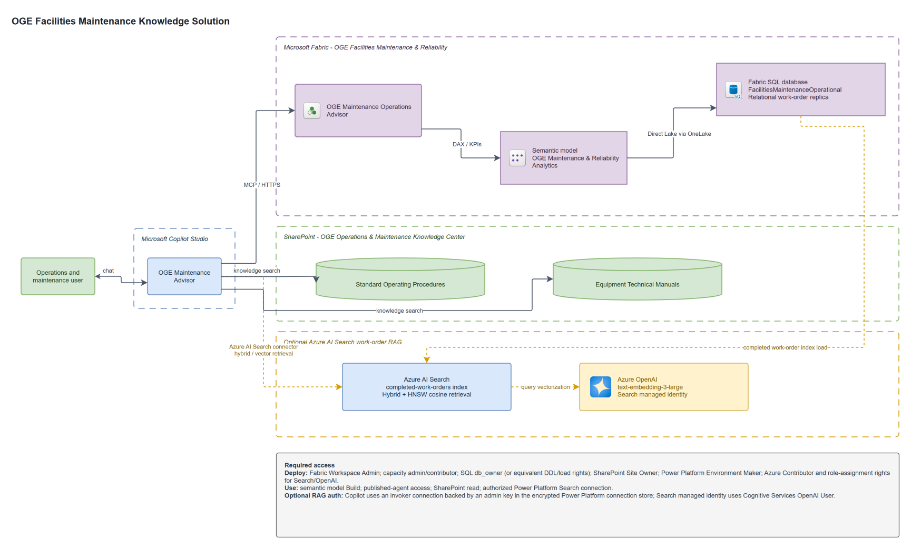

# Facilities Maintenance & Reliability AI Demo

This repository generates and deploys a fully synthetic utilities work-management
solution that combines:

- Microsoft Fabric lakehouse, Fabric SQL, and Direct Lake analytics
- a Fabric Data Agent for governed structured-data questions
- SharePoint controlled-document knowledge
- an optional Azure AI Search RAG layer for analogous completed work orders
- a Copilot Studio orchestration experience

All people, work orders, measurements, costs, and documents are synthetic. Nothing in
this repository represents live utility operations or authorizes maintenance work.

> [!IMPORTANT]
> This repository is a demonstration and deployment accelerator, not a production
> operations system. Review identity, networking, data governance, safety, and
> least-privilege requirements before adapting it to a real environment.

## Architecture



- [Editable draw.io source](diagrams/oge-solution-architecture.drawio)
- [SVG version](diagrams/oge-solution-architecture.svg)

The generated Maximo-shaped data is staged locally as Parquet, loaded into a relational
Fabric SQL replica, and exposed to the semantic model through Direct Lake. Managed
Delta copies are also materialized in the lakehouse as reproducible staging assets.

The Copilot Studio agent uses:

- the Fabric Data Agent, connected through Fabric IQ Data MCP, for governed metrics
- SharePoint SOP and technical-manual knowledge sources for controlled documents
- when enabled, the Azure AI Search connector for hybrid/vector retrieval over
  completed work orders

Fabric SQL remains relational. The analogous-work-order index is implemented in Azure
AI Search rather than through Fabric SQL vector functions or a separate custom MCP
server.

### Core deployment and optional work-order RAG

The core solution deploys the Fabric workspace, lakehouse, relational SQL replica,
semantic model, Data Agent, SharePoint knowledge sources, and Copilot Studio agent. It
does not require Azure OpenAI or Azure AI Search.

Set `ENABLE_WORK_ORDER_RAG=true` to provision the optional retrieval layer. The
provisioner:

1. creates or updates an Azure AI Search service
2. grants its managed identity access to the configured Azure OpenAI resource
3. builds a semantic and HNSW cosine index over completed `COMP` and `CLOSE` work orders
4. generates 1,536-dimension embeddings with `text-embedding-3-large`
5. uploads the work-order documents and runs a five-result retrieval smoke test
6. adds the Azure AI Search connector tool to Copilot Studio with invoker authentication

The connector connection is user-scoped. In a new environment, create an Azure AI
Search connection using **Access Key** authentication, the HTTPS Search endpoint, and
an administrator key retrieved at configuration time. Power Platform stores the key in
its encrypted connection store; the key is never written to repository files or
deployment JSON. Share the connection only with authorized agent users.

## Quick start: guided deployment

The recommended deployment path is [deploy_solution.ipynb](deploy_solution.ipynb).
It runs the implementation scripts in dependency order, captures IDs returned by Azure
and Fabric, writes those IDs to the local `.env`, and displays deployment smoke-test
results.

### Prerequisites

- Python 3.11 or newer
- PowerShell 7 or Windows PowerShell
- Azure CLI authenticated with `az login`
- a Microsoft Fabric F2 or higher capacity
- permission to create Fabric workspace items
- permission to create a Microsoft 365 group, SharePoint site, Entra application, and
  Microsoft Graph role assignment
- a Copilot Studio environment using the GitHub Copilot harness
- for optional work-order RAG, an Azure OpenAI embedding deployment and permission to
  create Azure AI Search and role assignments

### Required access

| Component | Deployment identity access | Runtime identity access |
|---|---|---|
| Azure subscription / resource group | Reader for discovery; Contributor when creating or changing Azure resources | None for the core solution |
| Fabric capacity | Capacity contributor or administrator to assign or resume capacity | None |
| Fabric workspace | Workspace Admin for item creation, updates, publication, and workspace identity | Data Agent users need access to the published workspace item or app |
| Fabric lakehouse and semantic model | Workspace Admin during deployment | Consumers require Build permission on the semantic model |
| Fabric SQL database | Workspace Admin during creation plus SQL `db_owner`, or equivalent create/load permissions | Used as the relational serving replica; no vector runtime access is required |
| Azure AI Search | Optional layer: Contributor plus role-assignment permission; permission to retrieve an admin key for connector setup | Power Platform connection users receive only the shared connector capability |
| Azure OpenAI | Optional layer: access to the embedding deployment and role-assignment permission | The Search service identity and deploying user require `Cognitive Services OpenAI User` |
| SharePoint | Site Owner or equivalent permission to create libraries, columns, and content | Copilot Studio users need read access to referenced content |
| Power Platform / Copilot Studio | Environment Maker plus permission to create, import, and publish agents | End users need permission to use the published agent and configured channel |
| Microsoft Graph / Entra | Delegated permission for configured SharePoint operations; tenant-admin consent may be required | No additional access beyond the selected channel and content permissions |

### Configure the environment

```powershell
Copy-Item .env.example .env
```

Populate the core bootstrap values:

- `FABRIC_CAPACITY_ID`
- `FABRIC_CAPACITY_RESOURCE_ID`
- `AZURE_SUBSCRIPTION_ID`
- `MICROSOFT_TENANT_ID`
- `SHAREPOINT_TENANT_HOST`

To deploy optional work-order RAG, set `ENABLE_WORK_ORDER_RAG=true` and populate:

- `AZURE_OPENAI_RESOURCE`
- `AZURE_OPENAI_RESOURCE_GROUP`
- `AZURE_OPENAI_EMBEDDING_DEPLOYMENT`
- `AZURE_AI_SEARCH_RESOURCE_GROUP`

Names can be changed before deployment. IDs for resources created by the notebook can
remain blank; the notebook populates them after each provisioning stage.

Never commit `.env`. It is intentionally ignored, while `.env.example` documents the
portable configuration contract.

### Run the notebook

Open [deploy_solution.ipynb](deploy_solution.ipynb) in VS Code or Jupyter and execute
the cells from top to bottom. The notebook:

1. validates prerequisites and installs pinned dependencies
2. generates deterministic Parquet data and controlled documents
3. provisions the Fabric workspace and lakehouse
4. creates the relational Fabric SQL replica and removes legacy SQL vector objects
5. optionally provisions and indexes Azure AI Search
6. deploys Delta staging tables and the Direct Lake semantic model
7. publishes the Fabric Data Agent and validates analytics
8. creates the SharePoint site and controlled-document libraries
9. configures the SharePoint knowledge sources and optional Azure AI Search tool in
   Copilot Studio, then publishes the agent

Copilot Studio connection consent and pulled `.mcs` metadata are tenant-specific. Keep
environment-specific pull output uncommitted.

## Direct script usage

The notebook orchestrates these reusable implementation modules:

```powershell
python -m pip install -r requirements.txt
python .\deployment\generate_demo.py
.\deployment\provision_fabric.ps1
python .\deployment\provision_fabric_sql.py
python .\deployment\provision_work_order_rag.py
python .\deployment\materialize_tables_and_model.py
.\deployment\provision_tables_and_model.ps1
python .\deployment\provision_data_agent.py
.\deployment\provision_sharepoint.ps1
.\deployment\provision_copilot_knowledge.ps1
```

Skip `provision_work_order_rag.py` when `ENABLE_WORK_ORDER_RAG=false`. When running
scripts directly, copy IDs from each JSON file under `generated/` into `.env` before
starting a dependent stage. The notebook performs this handoff automatically.

## Repository structure

| Path | Purpose |
|---|---|
| `deploy_solution.ipynb` | Guided, repeatable deployment |
| `deployment/` | Reusable Python and PowerShell deployment modules |
| `deployment/app_config.py` | Typed Python configuration loaded from `.env` |
| `deployment/Import-DotEnv.ps1` | Shared PowerShell `.env` loader |
| `deployment/generate_demo.py` | Deterministic synthetic data and document generation |
| `deployment/provision_fabric_sql.py` | Relational Fabric SQL replica and legacy vector-object cleanup |
| `deployment/provision_work_order_rag.py` | Optional Azure AI Search service, index, embeddings, upload, and smoke test |
| `deployment/materialize_tables_and_model.py` | Delta table and semantic-model generation |
| `deployment/provision_fabric.ps1` | Fabric workspace and lakehouse provisioning |
| `deployment/provision_tables_and_model.ps1` | Direct Lake tables and semantic model deployment |
| `deployment/provision_data_agent.py` | Data Agent source, publication, and analytics smoke test |
| `deployment/provision_sharepoint.ps1` | SharePoint libraries and controlled-document upload |
| `deployment/provision_copilot_knowledge.ps1` | SharePoint knowledge and optional Azure AI Search tool configuration |
| `copilot-studio/settings.mcs.yml` | Portable Copilot Studio instructions |
| `docs/` | Presenter guides and authored demo material |
| `generated/` | Local regenerated data and deployment state; ignored by Git |

## Data and retrieval behavior

The synthetic data follows common enterprise asset-management patterns:

- sites, locations, assets, classifications, labor, and crews
- job plans and preventive-maintenance schedules
- work orders, status history, labor, and material usage
- inventory, meter readings, and controlled-document metadata

The Azure AI Search index contains only completed `COMP` and `CLOSE` work orders.
Hybrid/vector retrieval returns historical evidence with work-order citations and
relevance values; it does not treat a historical cause as proven or a historical
remedy as an instruction.

For a production Oracle/Maximo source, replace the generated Parquet input with an
approved Fabric Data Factory Oracle copy pipeline. Preserve the source schema and use
Maximo `CHANGEDATE` or `ROWSTAMP` as the incremental watermark. Keep Oracle read-only.

## Security and local state

- Authentication uses Azure CLI, managed identity, or a Power Platform managed
  connection; credentials are not stored in source.
- Azure AI Search indexing uses an administrative key at deployment time, obtained
  dynamically from Azure CLI and never written to repository files.
- Copilot Studio uses an invoker Azure AI Search connection backed by an administrator
  key held in Power Platform's encrypted connection store. Limit connection sharing to
  authorized agent users.
- The SharePoint provisioner creates a short-lived Entra application, uses it to upload
  documents, and deletes it in a `finally` block.
- Azure, Fabric, tenant, Dataverse, and Copilot Studio identifiers live in `.env`.
- Generated deployment JSON, pulled Copilot metadata, caches, and editor temporary files
  are excluded by `.gitignore`.

## Demo

[OGE-Facilities-Maintenance-Demo-Script.docx](docs/OGE-Facilities-Maintenance-Demo-Script.docx)
contains a short presenter flow with prompts for analytics, analogous-work-order
retrieval, SharePoint grounding, and combined RAG.

## Contributing, security, and license

- See [CONTRIBUTING.md](CONTRIBUTING.md) before proposing a change.
- Report vulnerabilities privately as described in [SECURITY.md](SECURITY.md).
- This project is available under the [MIT License](LICENSE).
